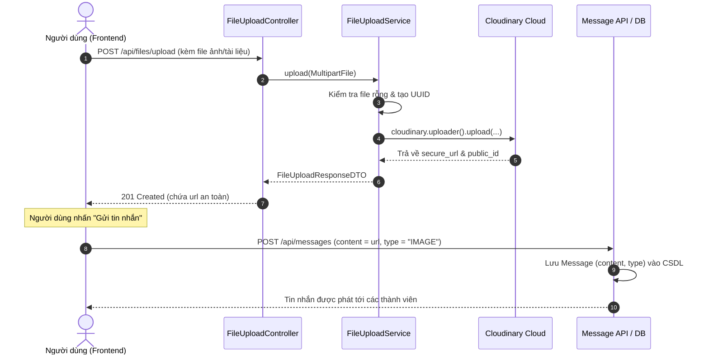

# Tài liệu Tích hợp Cloudinary & Xử lý Upload File/Ảnh cho Tin Nhắn

Tài liệu này tổng hợp toàn bộ các công việc, thay đổi mã nguồn, cấu hình và hướng dẫn sử dụng cho tính năng **Upload ảnh / File đính kèm qua Cloudinary** trong module `notification-dispatcher`.

---

## 1. Các vấn đề kỹ thuật đã xử lý

### 1.1. Sửa lỗi Dependency Maven
- **Lỗi ban đầu:** `Missing artifact com.cloudinary:cloudinary-http44:jar:2.7.0` tại `pom.xml:L83`.
- **Nguyên nhân:** Phiên bản `2.7.0` không tồn tại đối với artifact `cloudinary-http44` trên Maven Central (thường do nhầm lẫn với phiên bản npm của Node.js `cloudinary@2.7.0` hoặc Spring Boot 2.7.x).
- **Khắc phục:** Cập nhật phiên bản chính thức ổn định nhất của Cloudinary Java SDK là `1.39.0`.

### 1.2. Khắc phục cơ chế nạp cấu hình (Configuration Loading)
- **Vấn đề:** File `application-cloudinary.properties` không nằm trong danh sách active profile mặc định (`spring.profiles.default=dev`), dẫn đến việc Spring Boot không tìm thấy các thuộc tính `${cloudinary.cloud-name}` khi khởi chạy.
- **Khắc phục:** Bổ sung `@PropertySource(value = "classpath:application-cloudinary.properties", ignoreResourceNotFound = true)` vào class `CloudinaryConfig.java`.

### 1.3. Bảo mật thông tin xác thực (Credentials)
- Tránh hardcode trực tiếp `api-secret` vào mã nguồn khi đẩy lên Git.
- Cấu hình các biến môi trường dự phòng: `CLOUDINARY_CLOUD_NAME`, `CLOUDINARY_API_KEY`, `CLOUDINARY_API_SECRET` và cập nhật file `.env.example`.

### 1.4. Đồng bộ CSDL và Entity Message
- Ban đầu Entity `Message` và bảng `messages` trong CSDL chỉ có cột `content TEXT`, chưa có trường `type` để phân biệt tin nhắn chữ thường với ảnh/tập tin (trong khi `SendMessageRequestDTO` và `MessageResponseDTO` đã khai báo).
- Đã tạo migration Flyway `V4__add_type_to_messages.sql` và cập nhật trường `type` trong `Message.java`.

---

## 2. Danh sách các file tạo mới & chỉnh sửa

| Đường dẫn file | Trạng thái | Mô tả chi tiết |
|---|---|---|
| `notification-dispatcher/pom.xml` | Chỉnh sửa | Đổi `cloudinary-http44` thành version `1.39.0` |
| `src/main/resources/application-cloudinary.properties` | Chỉnh sửa | Cấu hình Cloudinary, giới hạn dung lượng upload `10MB` |
| `.env.example` | Chỉnh sửa | Bổ sung các biến môi trường mẫu cho Cloudinary |
| `src/main/java/.../config/CloudinaryConfig.java` | Chỉnh sửa | Bổ sung `@PropertySource`, khởi tạo `@Bean Cloudinary` |
| `src/main/java/.../DTO/FileUploadResponseDTO.java` | **Tạo mới** | DTO chứa thông tin file sau upload (url, publicId, format, size...) |
| `src/main/java/.../service/FileUploadService.java` | Chỉnh sửa | Thêm validate, tạo public_id UUID, hàm `upload` trả về DTO, hàm `deleteFile` |
| `src/main/java/.../controller/FileUploadController.java` | **Tạo mới** | REST Controller cung cấp endpoint `/api/files/upload` và `/api/files` |
| `src/main/resources/db/migration/V4__add_type_to_messages.sql` | **Tạo mới** | Script Flyway thêm cột `type VARCHAR(20) DEFAULT 'TEXT'` vào bảng `messages` |
| `src/main/java/.../entity/Message.java` | Chỉnh sửa | Thêm trường `type` (`TEXT`, `IMAGE`, `FILE`) |

---

## 3. Chi tiết REST API File Upload

Tất cả các API này đều yêu cầu JWT Token qua Header: `Authorization: Bearer <access_token>`.

### 3.1. Upload File / Ảnh
- **Method:** `POST`
- **URL:** `/api/files/upload`
- **Content-Type:** `multipart/form-data`
- **Request Body (Form Data):**
  - `file`: File cần upload (dung lượng tối đa: 10MB)

- **Response thành công (`201 CREATED`):**
```json
{
  "url": "https://res.cloudinary.com/yb9elvpc/image/upload/v1747382901/chatboxspringboot/3fa85f64-5717-4562-b3fc-2c963f66afa6.png",
  "publicId": "chatboxspringboot/3fa85f64-5717-4562-b3fc-2c963f66afa6",
  "originalFilename": "avatar_demo.png",
  "format": "png",
  "bytes": 204850,
  "resourceType": "image"
}
```

- **Mã lỗi thường gặp:**
  - `400 BAD_REQUEST`: File gửi lên bị rỗng hoặc không hợp lệ.
  - `401 UNAUTHORIZED`: Chưa truyền JWT Bearer token hoặc token hết hạn.
  - `500 INTERNAL_SERVER_ERROR`: Lỗi từ phía dịch vụ Cloudinary.

---

### 3.2. Xóa File trên Cloudinary
Dùng khi người dùng xóa hoặc thu hồi tin nhắn chứa ảnh/file đính kèm.

- **Method:** `DELETE`
- **URL:** `/api/files?publicId={publicId}`
- **Response thành công (`200 OK`):**
```json
{
  "message": "Xóa file thành công",
  "publicId": "chatboxspringboot/3fa85f64-5717-4562-b3fc-2c963f66afa6"
}
```

---

## 4. Luồng hoạt động trong Hệ thống Chat (Chat Flow)



---

## 5. Hướng dẫn kiểm thử

### 5.1. Biên dịch dự án
```powershell
cd notification-dispatcher
.\mvnw.cmd clean compile -DskipTests
```

### 5.2. Chạy thử nghiệm bằng cURL
```powershell
# 1. Upload ảnh
curl -X POST "http://localhost:8081/api/files/upload" `
  -H "Authorization: Bearer <TOKEN_JWT_CUA_BAN>" `
  -F "file=@C:\path\to\image.png"

# 2. Xóa ảnh bằng publicId
curl -X DELETE "http://localhost:8081/api/files?publicId=chatboxspringboot/your-file-id" `
  -H "Authorization: Bearer <TOKEN_JWT_CUA_BAN>"
```
